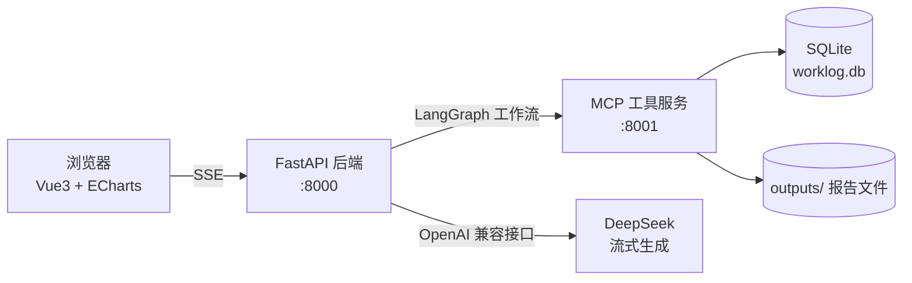

# AI Agent 自动化报告生成系统

基于 LangGraph 编排的多步 Agent 工作流，通过 MCP（Model Context Protocol）标准协议调用独立工具服务，
自动完成数据收集、图表生成、报告撰写与邮件投递；前端通过 SSE 实时展示 Agent 每一步执行状态与报告逐字输出。

- **技术栈**：LangGraph · MCP (FastMCP) · FastAPI · SSE · Vue3 · Vite · ECharts · SQLite
- **运行方式**：本地三服务一键启动 / Docker Compose 部署
- **当前状态**：功能闭环已跑通，使用脚本生成的演示数据；未接入真实业务数据源

---

## 效果演示

<!-- 建议放一张 30 秒 GIF：点击"开始生成" → Agent 步骤逐个点亮 → 报告逐字输出 → 图表渲染 -->


---

## 架构



工作流为四节点线性图，节点间通过共享 State 传递数据：

```
START → collect_data → generate_chart → write_report → send_email → END
```

| 节点 | 职责 | 调用工具 |
|---|---|---|
| `collect_data` | 拉取工作日志与量化指标 | `query_worklog`、`fetch_metrics` |
| `generate_chart` | 生成 ECharts 图表配置 | `generate_chart` |
| `write_report` | 调用大模型流式撰写报告 | — |
| `send_email` | 投递报告 | `send_report_email` |

MCP 工具服务独立进程运行，通过 `FastMCP` 暴露 4 个工具（`query_worklog`、`fetch_metrics`、
`generate_chart`、`send_report_email`），后端以 `ClientSession` + SSE 传输与其通信。

### 接口

| 接口 | 说明 |
|---|---|
| `GET /api/health` | 健康检查，返回 MCP 连接状态 |
| `GET /api/report/stream?type=daily\|weekly` | SSE 流式接口 |

SSE 事件类型：

| event | 内容 |
|---|---|
| `agent_step` | Agent 节点开始/结束，驱动前端时间线 |
| `agent_data` | 节点中间产物（如查到的工时汇总） |
| `report_token` | 报告文本增量（token 级） |
| `done` | 最终报告、图表配置、投递结果 |
| `error` | 异常信息 |

---

## 快速开始

### 环境要求

- Python 3.10+
- Node.js 18+
- 可选：DeepSeek API Key（或任意 OpenAI 兼容接口；不配置时自动降级为模板报告，全链路仍可跑通）

### 1. 启动后端（两个终端）

```bash
cd backend
pip install -r requirements.txt
cp .env.example .env        # 填入 DEEPSEEK_API_KEY（可留空）

# 终端 A：启动 MCP 工具服务（:8001）
python -m mcp_server.server

# 终端 B：启动后端（:8000）
python -m app.main
```

首次启动会自动生成最近 14 天的演示数据；也可手动执行 `python seed_data.py` 重新生成。

### 2. 启动前端

```bash
cd frontend
npm install
npm run dev                 # :5173
```

访问 http://localhost:5173，选择「日报 / 周报」后点击开始生成。

### 3. Windows 一键启动

```bash
start.bat                   # 自动拉起三个服务窗口
```

### 4. Docker 部署

```bash
export DEEPSEEK_API_KEY=sk-xxx
docker compose up -d --build
# 访问 http://localhost:8080
```

三个服务（`mcp-server` / `backend` / `frontend`）分别构建独立镜像，MCP 服务通过容器网络
`http://mcp-server:8001/sse` 被后端访问；`data/` 与 `outputs/` 以 volume 挂载持久化。

---

## 配置项

全部配置通过 `backend/.env` 注入（见 `.env.example`）：

| 变量 | 默认值 | 说明 |
|---|---|---|
| `DEEPSEEK_API_KEY` | 空 | 留空则跳过 LLM，使用模板兜底 |
| `LLM_BASE_URL` | `https://api.deepseek.com` | 任一 OpenAI 兼容地址（可指向本地 Ollama） |
| `LLM_MODEL` | `deepseek-chat` | 模型名 |
| `MCP_URL` | `http://127.0.0.1:8001/sse` | MCP 工具服务地址 |
| `SMTP_HOST` / `SMTP_PORT` / `SMTP_USER` / `SMTP_PASSWORD` / `SMTP_TO` | 空 | 未配置时邮件为演示模式，报告落盘至 `outputs/` |

---

## 设计取舍

| 决策点 | 采用方案 | 放弃的方案 | 原因 |
|---|---|---|---|
| 流程编排 | LangGraph `StateGraph` | 手写顺序调用 | 节点状态显式管理；`astream` 的 `updates` + `custom` 两种流模式可直接驱动前端时间线与 token 推送，后续加条件边或人工审核节点无需重构主干 |
| 工具接入 | 独立 MCP 服务 | 后端内直接函数调用 | 工具与编排解耦：新增/替换工具不触碰工作流代码，工具服务可被其他 Agent 复用，也可独立部署与扩容 |
| 实时推送 | SSE（`sse-starlette`） | WebSocket / 轮询 | 本场景为单向服务端推送，SSE 在 HTTP 上实现更简单，且断线由浏览器自动重连 |
| 报告数据来源 | 数据全部由工具查询返回，模型只负责组织与撰写 | 让模型直接生成数字 | 保证数据可溯源、避免幻觉；模型输出被限制在叙述层 |
| 无 API Key 场景 | 规则模板兜底生成报告 | 直接抛错中断 | 保证离线、断网及现场演示时全链路仍可跑通 |
| 部署形态 | Docker Compose 三服务 | 合并为单进程 | 与工具服务独立部署的实际形态一致，便于单独扩容与替换 |

---

## 已知限制

- 工作流为线性四节点，暂无条件分支、多 Agent 协作与人工审核节点
- 数据层为单机 SQLite，未做并发压力测试；当前数据由 `seed_data.py` 生成，非真实业务数据
- 未实现鉴权与限流，仅适用于内网或本地演示环境
- 邮件投递默认走演示模式（报告落盘 `outputs/`），真实发信需自行配置 SMTP
- 报告质量受输入数据结构影响较大，工具返回的文本格式变更需要同步调整提示词

---

## 目录结构

```
agent-report/
├── backend/
│   ├── app/
│   │   ├── main.py           # FastAPI 入口、SSE 接口、启动时连接 MCP
│   │   ├── agent.py          # LangGraph 工作流、流式 LLM 调用、模板兜底
│   │   ├── mcp_client.py     # MCP 客户端（ClientSession + SSE）
│   │   └── config.py         # pydantic-settings 配置
│   ├── mcp_server/
│   │   └── server.py         # FastMCP 工具服务（4 个工具）
│   ├── Dockerfile
│   └── requirements.txt
├── frontend/
│   ├── src/
│   │   ├── App.vue                # 主界面与状态管理
│   │   └── components/
│   │       ├── AgentFlow.vue      # Agent 执行时间线
│   │       └── ReportView.vue      # 报告渲染 + ECharts
│   ├── nginx.conf
│   └── Dockerfile
├── seed_data.py              # 演示数据生成
├── docker-compose.yml
├── start.bat / start.sh / stop.sh
├── data/                     # SQLite（运行时生成）
└── outputs/                  # 生成的报告（运行时生成）
```

---

## License

MIT
