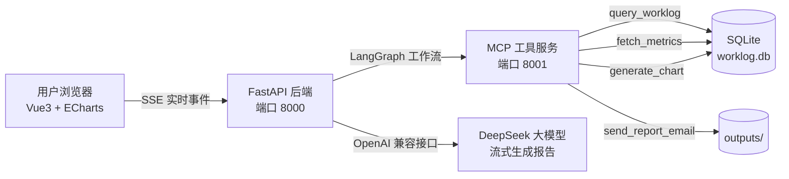

# 🤖 AI Agent 自动化日报/周报生成器

一个基于 **LangGraph 多步 Agent 工作流 + MCP 工具服务** 的智能报告生成系统。
用户一键触发，Agent 自动完成：**收集数据 → 生成图表 → 大模型撰写报告（流式输出）→ 投递报告**，全过程在前端实时可视化。

## ✨ 核心亮点

| 能力 | 说明 |
|---|---|
| 🧭 **LangGraph 多步工作流** | 4 个节点的有向图编排：数据收集 → 图表生成 → LLM 撰写 → 邮件投递 |
| 🔌 **MCP 工具服务** | 基于 Model Context Protocol 标准实现独立工具服务（SSE 传输），Agent 通过标准协议调用 |
| ⚡ **SSE 实时流式** | 前端实时看到 Agent 每一步执行过程 + 报告逐字输出（token 级流式） |
| 📈 **数据驱动** | SQLite 演示数据 + ECharts 双轴趋势图（工时柱状 + 提交折线） |
| 📧 **报告投递** | SMTP 邮件发送（演示模式自动保存到 `outputs/`） |
| 🐳 **可部署** | Docker Compose 一键上云部署 |

## 🏗 架构



**Agent 工作流（LangGraph 节点编排）：**

```
START → collect_data → generate_chart → write_report → send_email → END
         │                │               │              │
       查询工作日志      生成趋势图      LLM 撰写报告    保存/发送
       查询量化指标      (ECharts配置)   (流式输出)       (SMTP/演示)
```

## 🚀 快速开始（本地开发）

### 0. 环境要求
- Python 3.10+
- Node.js 18+
- 一个 DeepSeek API Key（或任意 OpenAI 兼容接口，支持本地 Ollama）

### 1. 后端

```bash
cd backend
pip install -r requirements.txt

# 配置 API Key（复制 .env.example 为 .env 并填入）
cp .env.example .env

# ① 启动 MCP 工具服务
python -m mcp_server.server        # 端口 8001

# ② 启动后端（另开终端）
python -m app.main                 # 端口 8000
```

> 首次运行会自动生成演示数据（最近 14 天工作日志与指标），也可手动执行 `python seed_data.py` 重新生成。

### 2. 前端

```bash
cd frontend
npm install
npm run dev                        # 端口 5173
```

浏览器访问 **http://localhost:5173**，选择「日报/周报」→ 点击「🚀 开始生成」。

### 3. 一键启动（Windows）

```bash
start.bat     # 自动打开 3 个窗口启动全部服务
```

## 🐳 Docker 部署（上云）

```bash
# 在服务器上
git clone <你的仓库> && cd agent-report
export DEEPSEEK_API_KEY=sk-xxx
docker compose up -d --build
# 访问 http://服务器IP:8080
```

## 🗂 项目结构

```
agent-report/
├── backend/
│   ├── app/
│   │   ├── main.py          # FastAPI + SSE 流式接口
│   │   ├── agent.py         # LangGraph 工作流 + 流式 LLM 调用
│   │   ├── mcp_client.py    # MCP 客户端（标准协议连接工具服务）
│   │   └── config.py        # 环境配置
│   └── mcp_server/
│       └── server.py        # MCP 工具服务（4 个工具）
├── frontend/
│   └── src/
│       ├── App.vue          # 主界面（控制 + 状态管理）
│       └── components/
│           ├── AgentFlow.vue    # Agent 执行流时间线
│           └── ReportView.vue   # 报告渲染 + ECharts 图表
├── seed_data.py             # 演示数据生成
├── data/                    # SQLite 数据库（自动生成）
├── outputs/                 # 生成的报告文件
└── docker-compose.yml
```

## 🎯 技术栈

- **Agent 编排**: LangGraph（StateGraph + 自定义流式事件）
- **工具协议**: MCP (Model Context Protocol) - FastMCP 服务端 / ClientSession 客户端
- **后端**: FastAPI + sse-starlette（SSE 实时推送）
- **大模型**: DeepSeek API（OpenAI 兼容，httpx 流式解析）
- **前端**: Vue3 + Vite + ECharts + marked

## 🔍 常规问题回答

1. **为什么用 LangGraph 而不是直接循环调用？** —— 节点编排、状态管理、可流式观测、可扩展（加分支/条件边）
2. **MCP 解决了什么问题？** —— 工具调用的标准协议，避免每个 Agent 各自实现工具接口，生态互通
3. **如何保证报告质量/减少幻觉？** —— 数据全部来自工具返回（grounding），LLM 只做格式化撰写
4. **SSE 和 WebSocket 区别？** —— 单向服务端推送适合此场景，实现简单、断线自动重连
5. **如果数据量变大怎么办？** —— 工具服务可横向扩展、消息队列削峰、数据库分表

## 📝 简单概述

> **AI Agent 自动化报告生成系统（独立开发）**
> 基于 LangGraph 构建多步 Agent 工作流，通过 MCP 标准协议连接独立工具服务，实现数据收集→图表生成→LLM 流式撰写→邮件投递的自动化闭环；前端基于 Vue3 通过 SSE 实时可视化 Agent 执行过程与逐字输出效果，后端采用 FastAPI + 异步流式架构，支持 Docker 一键部署。
